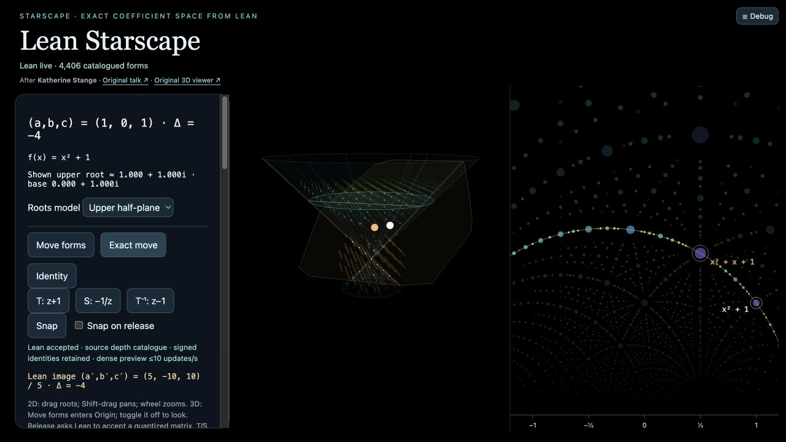

# Lean Starscape

**Starscape’s signed polynomial space, driven by executable Lean.**

This project implements Katherine Stange’s Starscape/Lattice interactions with
an exact Lean computation service, a browser/WebXR renderer, and a native
visionOS renderer. The target is the same Starscape functionality: signed
polynomial selection, linked roots and coefficient space, cutting planes,
Möbius transformations, Snap, and spatial navigation.

The app opens at **[http://127.0.0.1:8787](http://127.0.0.1:8787)**.
The existing `/polynomial/` URL and `PolynomialRoom` Xcode scheme remain valid.
The repository name stays `alok/exterior-room`; its earlier vector/wedge
experiment is preserved separately at `/exterior/` and is not part of the
Starscape parity claim.



## Run locally

Use Python 3.10+, Xcode Command Line Tools, and elan with the pinned Lean compiler:

```sh
elan toolchain install leanprover/lean4:v4.35.0-rc3
./scripts/run.sh
```

Open port **8787** and keep the terminal running. `Ctrl-C` stops the bridge.
The script builds the Lean executables sequentially; subsequent runs reuse their
artifacts. There are no external Lake/Python packages or browser CDN dependencies.
Three.js and OrbitControls are bundled. After compiler installation, the demo
runs without an external network connection. Node.js is only needed for tests.

With executables already built, `python3 server.py` starts the bridge directly.
It binds to loopback by default. Port 8778 is reserved for the separate canonical
FareyVision checkout and is rejected here. GitHub contains source and evidence;
this is **not a hosted app or Lean compiled to WebAssembly**.

## Try the same Starscape operations

1. Inspect the default signed form `(1,−1,2)`, Δ = −7. **Next point** preserves
   a multiple’s distinct coefficients even when it shares another form’s root.
2. Select `(1,0,1)`, enter `(1,1,1)`, then **Pair entered point**. Lean returns
   `2a − 2c = 0`, endpoints −1 and 1, and 22 interior triples in Canonical ball R6.
3. Toggle projection, **Origin**, **Other side**, **Inhabit**, and Overview.
   Change size, palette and plane fade; Reset retains appearance preferences.
4. Drag the roots pane (choose **2D roots** in a narrow window); **Move forms** enables the corresponding
   coefficient-space manipulation in Origin. The accepted action moves the
   points, roots and cutting plane together. **Exact move** gives a repeatable
   rational checkpoint.
5. **Snap** absorbs the chosen integer symmetry into the signed identities.
   **Identity** resets the viewing action while preserving those new labels.
   Select `(13,20,34)` and apply **T** to obtain `(13,−6,27)`. The source
   vertical-drag counterexample followed by **Snap** instead absorbs **T⁴**,
   giving `(13,−84,162)`, still with Δ = −1368. Exact identities may be outside
   the displayed crop. Canonical mode marks them hidden; Source retains independent
   selection rings even when a body is outside the crop.

Choose **Source depth** to use the original viewer’s upper trace and other-point
catalogues, with primitive upper roots and Whole/Dust controls. Entering Source
from a smaller crop chooses depth **16**; the original viewer defaults to **48**.
**Project/Lift** moves upper stars continuously to a disk at `Y=.6×depth` by
default. Screen visibility and height are separate controls. Nonprimitive upper
bodies fade out; their signed selections remain. Canonical ball keeps its separate
fixed signed-ball contract and `Y=4` projection overlay.

During a held drag, bounded quantized samples request fresh Lean catalogues and
plane membership. These scenes are temporary: release accepts the exact action
and matching catalogue together, while cancellation restores the accepted scene.
See the [native preview/render update](docs/NATIVE_PREVIEW_RENDER_UPDATE.md),
[morph checkpoint](docs/SOURCE_MORPH_UPDATE.md),
[source numerical audit](docs/source-projection-morph-audit.md), and
[catalogue bounds](docs/SOURCE_CATALOGUE_UPDATE.md).

[Two-minute guide](docs/SHOWCASE.md) · [behavior/parity matrix](docs/FUNCTIONAL_PARITY.md)

## What matches, and what is still missing

The [native preview/render update](docs/NATIVE_PREVIEW_RENDER_UPDATE.md),
[source-morph update](docs/SOURCE_MORPH_UPDATE.md),
[source-catalogue update](docs/SOURCE_CATALOGUE_UPDATE.md),
[linked-roots update](docs/LINKED_ROOTS_UPDATE.md),
[polar-Snap checkpoint](docs/STARSCAPE_PARITY_UPDATE.md) and
[earlier validation receipt](docs/POLYNOMIAL_VALIDATION.md) separate arithmetic
checks, actual browser interactions, simulator interactions and synthetic XR.
Full functional or visual parity has **not** been established.

| Behavior | Current evidence and limits |
| --- | --- |
| Signed points, exact selection, pairs and cutting planes | Lean output compared against canonical fixtures. Both renderers show the same R6 pair, plane and 22 members. |
| Colors, size, fade and projection | Source morph position, radius and opacity are checked against 48 evaluations of the deployed numerical code. Actual browser and simulator controls reach 0%, 50% and 100%. Transparent native guides no longer hide projected stars; the fix passes matched simulator inspection. A full Source16 radius/alpha audit has zero source/browser discrepancies. Materials, glyph footprint, mesh sampling and camera framing still differ. |
| Linked Möbius motion, Snap and Identity | Browser 2D/3D pointer motion and synthetic controller motion tested. Native Roots swipe and directional controls tested. Origin free-space drag is implemented and model-tested, but actual input remains unverified. |
| Roots chart | Browser shows linked 3D/UHP panes together on wide windows, with an optional Klein model. Native now has a separate linked UHP Roots window with selection, pairing, labels and geodesics. Other source models and theme controls remain gaps. |
| Selection and hover | Browser polynomial hover and picking are exercised. Native Roots has actual simulator tap/pair evidence and a cancellable Lean hover inspector; its pointer-hover callback remains unverified because visionOS XCUI excludes hover. Physical gaze/pinch and explicit controller bindings are unverified. |
| Density and crop | Separate Canonical ball and Source depth modes. The preceding source receipt rendered 769,788 buffered forms at depth96 with an explicit upper-cap notice; depth24 has 14,966. Native supports R24/28,832 canonical forms with a 40,000-form budget. Browser held-drag recropping passes actual input tests. Native release recropping and the unchanged strict held-preview test now pass: one temporary catalogue published 1.23 seconds before gesture end in the recorded Source16 gesture. Broader dense interaction performance remains unverified. |
| Origin, Inhabit, Overview, Reset | Tested on each route. Camera offsets, field of view, materials and control layouts differ. |
| Headsets | Synthetic WebXR runs real Three.js rendering/handlers with supplied poses. visionOS Simulator runs the native app. Neither establishes physical tracking, compositor behavior, comfort or hardware performance. |

Main Chrome's existing URL-based connection was rechecked and failed with
`Emulation.setFocusEmulationEnabled` timed out; current actual browser interaction evidence uses the
in-app browser. All limitations
remain visible rather than being inferred away from a successful Lean response.

## Proof and execution boundary

| Layer | What actually happens |
| --- | --- |
| Kernel-checked | 17 general integer identities cover coordinate/discriminant formulas, plane incidence and Möbius action laws. Sixteen axiom audits use only standard Lean axioms. |
| Executable Lean | A native Mac process enumerates canonical signed balls and source trace/other-point catalogues and computes inspections, symbolic roots, exact planes/membership and the rational action `J(M)/det(M)`. |
| Client preview and Snap choice | Floating-point dragging, quantization and choosing a candidate integer symmetry occur in the client. Lean computes exact sampled catalogues and the submitted rational action. Preview catalogues remain temporary until matching release validation. |
| Source morph fixtures | 48 offline executions of the pinned deployed numerical routines record identity/D5 positions, radii, opacities, markers and guides at progress 0, .5 and 1. They are regression data, not additional proofs. |
| Exported fixtures | Native preset data are generated by the actual executable with receipts. Live computations require the Mac bridge. |
| Rendering and transport | Three.js/RealityKit handle floating-point coordinates, meshes, colors, cameras and input. JSON, HTTP, compiler/runtime execution and renderers are outside the kernel proof boundary. |

A live result is an exact Lean calculation, **not a new proof certificate for
that request**. Enumeration completeness, gcd/radical normalization and the
compiler/runtime have tests; the 17 identities do not prove them.
[Proof source and receipts](lean/Polynomial/README.md) ·
[JSON protocol](lean/Polynomial/PROTOCOL.md) ·
[interactive boundary](web/polynomial/boundary.html).

## Native visionOS

Open `native/ExteriorRoom.xcodeproj` and choose **PolynomialRoom**. Bundle and
scheme names remain stable. The app uses RealityKit and the same Lean schemas.
Bundled preset playback works without the bridge; live results run on the Mac.
Lean does not execute inside visionOS. See [native instructions](native/README.md)
for the simulator build and existing test routes.
Use **Roots…** to open the linked upper-half-plane window; choose Select, Pair,
Move or Pan. Zoom/Fit changes the chart without changing the accepted action.

Device loopback refers to the device, not the Mac. A physical native route needs
a reachable Mac bridge; device signing/installation and physical acceptance are
not established here. WebXR also needs a secure context on a headset; the local
server does not configure HTTPS or public hosting.

## Tested evidence

- [Current browser morph/recrop clip](artifacts/videos/lean-starscape-browser-morph.mp4),
  [native morph/Roots clip with restored projected stars](artifacts/videos/lean-starscape-native-morph-depth-fix.mp4),
  and [synthetic WebXR clip](artifacts/videos/lean-starscape-webxr-morph.mp4).
  The [native continuation](docs/NATIVE_PREVIEW_RENDER_UPDATE.md) records 147 model
  tests, passing matched-morph and strict held-preview simulator sequences, and
  preserved earlier failures. [Accepted held-preview clip](artifacts/videos/lean-starscape-native-held-preview-accepted.mp4).
  Exact Lean scan optimization passes 60 full old/new response comparisons and
  121 catalogue checks; the 17 public laws remain unchanged.
  The [browser checkpoint](docs/SOURCE_MORPH_UPDATE.md) records 160 browser tests,
  26 bridge tests and 121 Lean catalogue requests. Each receipt identifies its
  tested build; these are distinct from physical-headset evidence.
- [Source-catalogue paired browser video](artifacts/videos/lean-starscape-source-catalogue.mp4):
  real D5, root dragging, recropping, Snap and Identity.
  [Acceptance and limitations](docs/SOURCE_CATALOGUE_UPDATE.md) include actual
  source controls, depth24/96, cancelled drag, narrow layout and synthetic XR.
- [Native source-catalogue clip](artifacts/videos/lean-starscape-native-catalogue.mp4):
  actual simulator controls through R24, source pair/D5, primitive projection,
  Dust and Reset. [Native receipt](native/evidence/catalogue-native-receipt.json).

- [Simultaneous 3D and roots video](artifacts/videos/lean-starscape-linked-panes.mp4):
  actual desktop D5, root drag, Snap and Identity on the shared unit/pair.
  [Current screenshots and states](artifacts/screenshots/linked-roots-20261023/)
  also cover hover, responsive layout, R24 and synthetic XR restoration.
- [Native linked Roots sequence](artifacts/videos/lean-starscape-native-linked-roots.mp4):
  actual simulator taps/pairing, D5, free root swipe, pan/zoom/Fit and reopening.
  [Matched D5 visual inspection and limits](docs/LINKED_ROOTS_UPDATE.md#matched-visual-inspection).
- [Current UHP drag/Snap video](artifacts/videos/lean-starscape-browser-polar-snap.mp4)
  and [native polar-Snap video](artifacts/videos/lean-starscape-native-polar-snap.mp4):
  the same T⁴ result through browser pointer motion versus a declared native
  matrix preset plus actual Snap controls. Input routes and charts differ.

- [Matched browser sequence](artifacts/videos/polynomial-browser-matched-render.mp4)
  and [native sequence](artifacts/videos/polynomial-native-matched-render.mp4):
  Identity → D5 → fade off → fade on with projection, using the same R6 pair.
- [Native disk swipe](artifacts/videos/polynomial-native-klein-swipe.mp4): actual
  simulator gesture, accepted Lean matrix, return to Overview.
- [Browser roots/Snap](artifacts/videos/polynomial-roots-snap.mp4) and
  [3D Origin motion](artifacts/videos/polynomial-origin-drag.mp4).
- [Synthetic XR motion](artifacts/videos/polynomial-xr-mobius.mp4): supplied
  controller poses, real application rendering and event handlers.

Current morph/preview acceptance and remaining input gaps are tracked in the
[native continuation](docs/NATIVE_PREVIEW_RENDER_UPDATE.md) and the preceding
[browser checkpoint](docs/SOURCE_MORPH_UPDATE.md). The source fixture generator passes all 48 cases and its
independent harness invariants. The kernel theorem count remains **17**.

These silent app-only clips have dated [metadata and limits](artifacts/videos/README.md).
Older clips retain their original “Polynomial Room” label. They are not current
hardware evidence. The preceding source-catalogue continuation passed **138 Node tests**, **121 catalogue
service requests** and the five-case source oracle comparison. Its native
validation passed **114 model tests**, the unsigned visionOS build, and one
108.059-second source-catalogue simulator UI sequence; its matching data and
visual limits are recorded in the source-catalogue update. The preceding
linked-roots checkpoint passed 115 Node tests and 88 native model tests; its
source hashes remain historical evidence.
The preceding checkpoint passed 26 bridge tests and the focused native polar-Snap UI test. Historical
62-test/swipe receipts remain dated records, not retested source hashes.

```sh
python3 lean/Polynomial/build.py
python3 lean/Polynomial/test_service.py
python3 lean/Polynomial/test_transform.py
python3 lean/Polynomial/test_catalogue.py
python3 -m unittest discover -s tests -p 'test_*.py'
node --test tests/*.test.mjs
swift test --package-path native --scratch-path native/.build/swift-tests -j 2
```

The polynomial service comparison covers 305 requests and 2,120,040 ordered
points across tested crops. Another 452 requests cover rational transformations,
composition and pinned Snap absorption fixtures. These arithmetic tests are
separate from rendering and interaction acceptance.

## Attribution and preserved work

The polynomial-space construction follows **Katherine Stange** and the
Harriss–Stange–Trettel *Algebraic Number Starscapes* work. Pinned FareyVision
renderer modules and control patterns retain their notices and provenance;
see [the manifest](web/polynomial/PROVENANCE.json) and [NOTICE](NOTICE.md).
New Lean implementation and proofs are this project’s work, not attributed to Stange.

The combined distribution is **AGPL-3.0-or-later**; borrowed FareyVision files
retain GPL notices and Three.js retains MIT. The earlier Grassmann experiment
and its provenance remain in [the archive guide](EXTERIOR_ROOM_ARCHIVE.md).
No exterior-algebra feature is counted as Starscape functionality.
