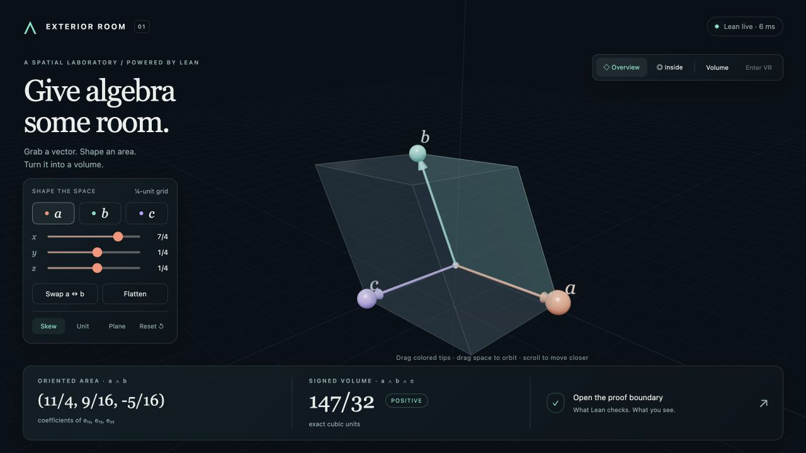
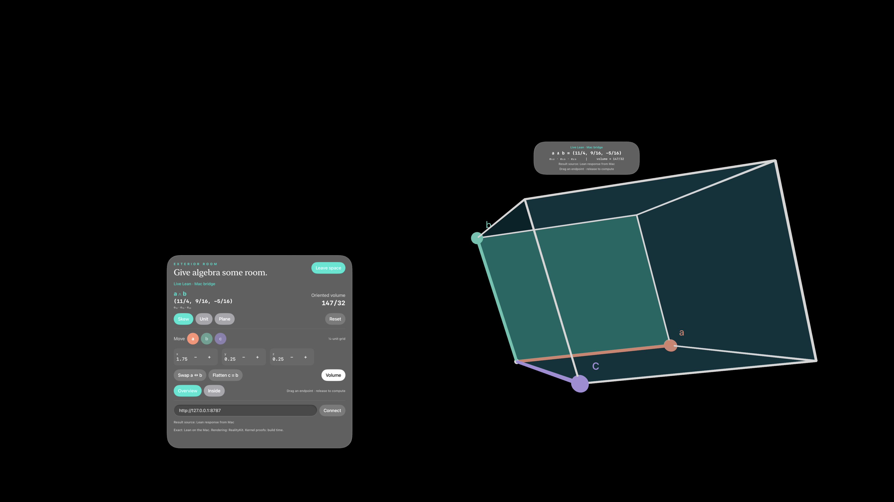

# Exterior Room

**Grab a vector. Shape an area. Turn it into a volume.**

Exterior Room is an interactive spatial demonstration of exact exterior algebra
computed by Lean. Three vectors define an oriented area and volume; moving their
tips sends integer coordinates to a native Lean process and draws its response
in a browser or a separate visionOS app.

The algebra comes from a pinned snapshot of the Grassmann Lean codebase. The
browser and RealityKit app are renderers and input clients. Neither substitutes
JavaScript or Swift exterior-product calculations for Lean.



Live browser controls, coordinate editing, pointer dragging, and responsive
layouts were exercised in the in-app browser. The native simulator sequence also
passes. Inspected matching states agree on exact readouts, vector colors, and
geometry. Main Chrome interaction acceptance, immersive WebXR, and physical
Vision Pro testing remain pending. See the [validation receipt](docs/VALIDATION.md).

## Run on a Mac

Install Python 3.10 or newer, the Xcode Command Line Tools, and Lean through elan
using its standard `~/.elan` toolchain directory. Install the pinned compiler if
it is not already present:

```sh
elan toolchain install leanprover/lean4:v4.35.0-rc3
```

From this checkout:

```sh
./scripts/run.sh
```

Open **[http://127.0.0.1:8787](http://127.0.0.1:8787)**. Keep the terminal running;
`Ctrl-C` stops the server. The script builds the Lean executable before starting
the local bridge. Its sequential build limits concurrency to keep the Mac
responsive. Subsequent runs reuse local build artifacts.

There are no external Lake packages, Python packages, or browser CDN dependencies
to install. Three.js and OrbitControls are bundled. After the compiler is
installed, building and running require no external network access. Node.js is
needed only for the JavaScript tests.

If the executable is already built, start just the bridge with:

```sh
python3 server.py
```

The server binds to loopback by default. Port 8778 is reserved for the separate
FareyVision application and is rejected by this server.

## Explore

- Drag a colored vector tip, or select **a**, **b**, or **c** and use its coordinate
  controls. Inputs snap to quarter-unit coordinates in the range −3 to 3 per axis.
- **Swap a ↔ b** reverses the oriented area and signed volume.
- **Flatten** sets `c = b`; Lean computes the resulting zero volume.
- **Skew**, **Unit**, and **Plane** provide reproducible starting configurations.
- **Overview** frames the shape; **Inside** moves the view into its space. Drag
  empty space to orbit and scroll to change distance.
- Open **the proof boundary** for the current exact coefficients, source receipt,
  and JSON export.

The highlighted face represents `a ∧ b`; its three coefficients use the ordered
basis `[e₁₂, e₁₃, e₂₃]`. The full parallelepiped represents `a ∧ b ∧ c`; its
`e₁₂₃` coefficient is signed volume. The area readout is a bivector, not its
Euclidean magnitude.

**Enter VR** becomes available when the browser reports an immersive WebXR
device. Headset-browser use requires a secure context; plain HTTP at a Mac's LAN
address is not sufficient for WebXR. The local server does not configure HTTPS.
Physical-headset interaction and performance have not been verified.

## What Lean proves, computes, and exports

| Layer | Actual boundary |
| --- | --- |
| Kernel-checked statements | General integer identities and agreement between the generated Grassmann kernels and their coordinate/reference formulas. The service-wrapper theorems include self-wedge zero, swapping the first two vectors negating volume, and zero volume for `c = a + b`. |
| Executable Lean | Each accepted live request runs Grassmann's generated wedge and triple-wedge operations in a native Lean process. The service returns exact integer coefficients and eight vertices. |
| Exported data | The native app bundles three JSON presets generated by that executable. Preset playback is labeled separately from a live calculation. |
| Rendering and interaction | Three.js and RealityKit convert coordinates to floating point and handle meshes, cameras, pointer/controller input, and lighting. These parts are not kernel-verified. |

A live result is a Lean calculation, **not a new kernel proof attached to that
request**. The compiler/runtime and JSON/HTTP transport are also outside the
kernel proof boundary. The imported code includes implementation caches and
`unsafe` helpers; runtime tests therefore complement the logical axiom audit.

Lengths use integer coordinates divided by 4, area coefficients by 16, and
volume by 64. For example, the unit-world-cube request uses vectors
`[4,0,0]`, `[0,4,0]`, and `[0,0,4]`; Lean returns wedge `[16,0,0]` and volume `64`.
Those are displayed as area coefficient 1 and volume 1. When the bridge fails,
the interface retains the last accepted geometry and marks it as previous data.

See the [Lean source and proof receipt](docs/lean-provenance.md),
[service-wrapper proofs](lean/Exact/Proofs.lean), and
[axiom audit](lean/evidence/axiom-audit.txt) for precise statements and dependencies.

## Native visionOS route

The separate `com.alok.ExteriorRoom` application uses RealityKit and the same
Lean response schema. It offers two explicit modes:

- **Lean export · preset playback:** bundled Lean-generated data, usable without
  the Mac bridge.
- **Live Lean · Mac bridge:** exact calculations run on the Mac. Coordinate
  controls and released endpoint drags request new results.



The screenshot is a simulator capture, not evidence of physical Vision Pro use.
The native UI test passed with nine captured stages. The browser and native Skew
views both show wedge `(11/4, 9/16, -5/16)`, volume `147/32`, the same vector
colors, and an eight-vertex solid with the highlighted area face. Cameras,
scales, materials, and interface layouts differ; pixel-identical rendering is
not a goal. The recorded Unit, swapped, flattened, Plane, and coordinate-edited
states also agree on exact values. See [validation status](docs/VALIDATION.md)
for the tested workflows and remaining Chrome and hardware checks.

Follow [native/README.md](native/README.md) for Xcode build and decoder/bridge test
commands. The recorded unsigned simulator build used Xcode 27.2 beta and the
visionOS 27.2 Simulator SDK. Lean is not embedded in, or executed on, visionOS.

For a physical device's native app, loopback addresses refer to that device.
The Mac bridge must instead be explicitly bound to a reachable interface, for
example `./scripts/run.sh --host 0.0.0.0`, and the app must use the Mac's private
IP address. This exposes the local demo bridge to the LAN; it is not a public
hosting configuration. Device signing, installation, and hardware testing are
not included in the recorded validation.

## Tests and evidence

```sh
python3 lean/build.py
python3 lean/test_service.py
python3 -m unittest discover -s tests -p 'test_*.py'
node --test tests/*.test.mjs
swift test --package-path native --scratch-path native/.build/swift-tests -j 2
```

Recorded checks pass for the Lean build and axiom audit, 255 valid plus 8 invalid
Lean service cases, 16 bridge tests, 18 JavaScript tests, and 11 native model tests.
Native decoding and live bridge sequences also pass. The native simulator UI
test passed with zero failures in 126.317 seconds, covering connection,
entry/exit, presets, swap, flatten, coordinate editing, inside view, volume
visibility, and reset. Supplemental in-app-browser checks cover presets, swap,
flatten, a quarter-step keyboard edit, pointer dragging, inside view, volume
visibility, reset, and the proof panel. Saved 390×844 and 900×500 viewport captures
cover the responsive layouts. Main Chrome automation still blocks completion of
its interaction checks; immersive WebXR and tracked-hand dragging remain
unverified. These checks do not establish physical-device behavior.

## Source and licensing

Grassmann is pinned at `87e12dcfac41a0703bd0192f5e5a9b5e4c82d610`.
The [vendor manifest](lean/vendor/PROVENANCE.json) records all 110 copied modules
and their SHA-256 hashes. Browser XR/input helpers and native application patterns
come from FareyVision at `8b32d7ae8f67fc47f381407bbcdf6f24e28de771`.

The combined distribution is **AGPL-3.0-or-later**. Grassmann retains its AGPL
license, FareyVision-derived files retain their GPL notices, and Three.js retains
its MIT license. See [LICENSE](LICENSE) and [NOTICE.md](NOTICE.md).
Katherine Stange's attribution belongs to the reference Farey exhibit; this
application does not attribute its new exterior-algebra scene to her.
